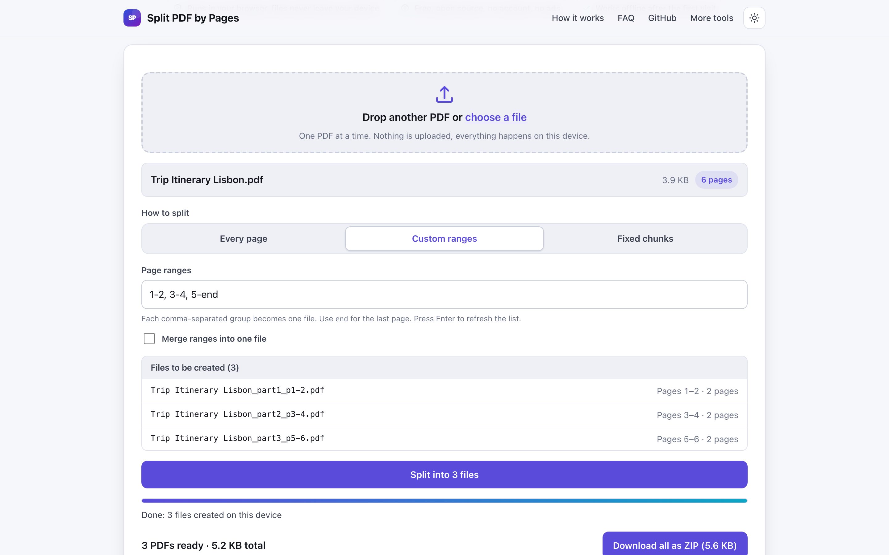
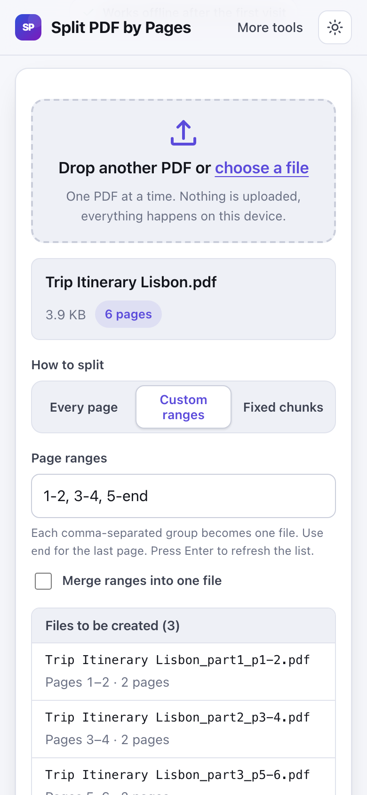

# Split PDF by Pages

> Split a PDF into single pages or custom ranges in your browser and save them as a ZIP, nothing uploaded.

**🌐 Use it now: [turhe123.github.io/split-pdf-pages-local](https://turhe123.github.io/split-pdf-pages-local/)** · free · open source · runs in your browser · works offline

  

## Why

Split PDF by Pages is a free, open-source alternative to Smallpdf Split PDF, whose free use is limited to a couple of tasks per day, uploads your files and asks for an account to go further. Here your files never leave your device, there is no account, no ads and no limits, and it works offline and can be installed as an app.

## Screenshots

<p align="center"></p>

<p align="center"><em>Split PDF by Pages in the browser, light theme</em></p>

<p align="center"></p>

<p align="center"><em>Split PDF by Pages on a phone</em></p>

## Features

- Three ways to split: every page as its own file, custom ranges (each comma-separated group becomes one file), or fixed chunks of N pages.
- Optional "Merge ranges into one file" to extract a set of pages into a single PDF, in the order you typed them.
- Tolerant range parser: spaces, hyphens or en dashes, semicolons or commas, a trailing comma, and the words `end` or `last` (for example `1-3, 4, 5-end`).
- Overlapping ranges are allowed and produce duplicated pages.
- Inline errors under the field for empty input, out-of-range pages, reversed ranges such as `5-3`, and invalid chunk sizes.
- Live preview of the files to be created, with names such as `report_part1_p1-3.pdf` and their page counts. Press Enter in the ranges or chunk field to refresh it.
- Output names are derived from the source file name; unicode is kept and illegal characters are replaced.
- Progress bar while files are created. The PDF work runs in a Web Worker so the page stays responsive.
- Results list with a download button per file, plus "Download all as ZIP" when more than one file is produced (ZIP uses STORE, no recompression). A single result downloads directly.
- Notes for very large inputs (over 200 MB) and for jobs that create more than 100 files.
- Drag and drop or file picker, keyboard accessible, light and dark themes, layout for narrow phones.
- Installable and usable offline through a service worker.

**Input:** one PDF at a time (extra PDFs dropped together are ignored with a note; non-PDF files are rejected).
**Output:** PDF files, or a ZIP of PDFs.
**Limits:** password-protected or encrypted PDFs are not supported. Everything is held in memory, so very large files depend on your device; a warning appears above 200 MB. Building a large ZIP can be slow on phones.

## How to use

1. Drop a PDF onto the page or choose it with the file picker. The file name, size and page count appear.
2. Pick a mode: Every page, Custom ranges (for example `1-3, 4, 5-8`), or Fixed chunks (pages per file).
3. Check the "Files to be created" list, and fix any error shown under the input.
4. Press Split.
5. Download files one by one, or use Download all as ZIP.

## Privacy

- Your PDF is never uploaded. It is read and split in your browser, on your device.
- No cookies.
- Page views are counted anonymously with [GoatCounter](https://www.goatcounter.com/) (cookieless, open source). No file data is included.
- After the first visit a service worker caches the page, so it works offline.

## Run it locally

```sh
git clone https://github.com/turhe123/split-pdf-pages-local
cd split-pdf-pages-local
python3 -m http.server 4173
```

Then open http://127.0.0.1:4173/. There is no build step.

## Tests

```sh
npm i -D @playwright/test && npx playwright install chromium
npx playwright test
```

## Third-party code

Both libraries are copied into `vendor/` with their licenses; nothing is loaded from a CDN.

| Library | Version | License |
| --- | --- | --- |
| [pdf-lib](https://github.com/Hopding/pdf-lib) | 1.17.1 | MIT |
| [JSZip](https://github.com/Stuk/jszip) | 3.10.1 | MIT |

## Built with AI

Split PDF by Pages was written by [Claude Code](https://claude.com/claude-code) inside an automated pipeline, from a plain-English spec. No code or assets from any commercial product were used; it is a clean-room implementation of a feature set, not a copy.

What that means in practice:

- The full source is in this repo under the MIT license. Read it before you trust it with your files.
- Everything runs in your browser. It makes no network requests except an anonymous, cookieless page-view count (GoatCounter); your files never leave the device.
- The page is tested headless in Chromium (Playwright) before every release, but it has had less human review than hand-written software. Bug reports and pull requests are welcome.

## Support ❤️

If this saved you time or a subscription, you can say thanks on [Ko-fi](https://ko-fi.com/leodavidai).

## More free web tools

Find more at [turhe123.github.io/web-tools](https://turhe123.github.io/web-tools/).

Also: [free, open-source Mac apps](https://turhe123.github.io/mac-apps/) built the same way, native Swift, no accounts, no telemetry.

## License

MIT © Or Davidai Bachar
